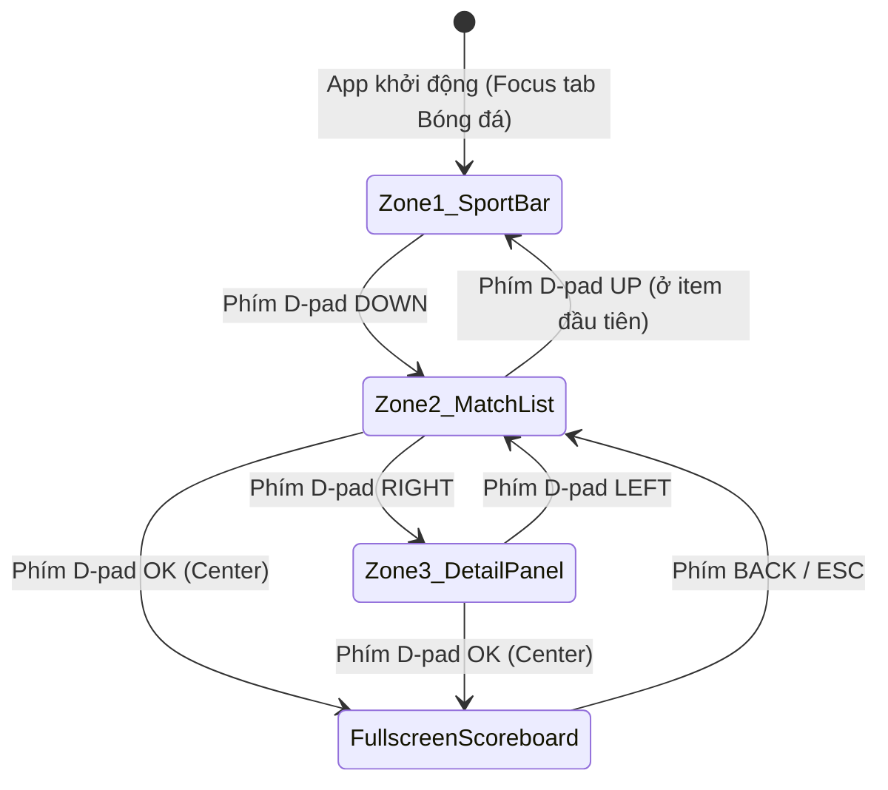
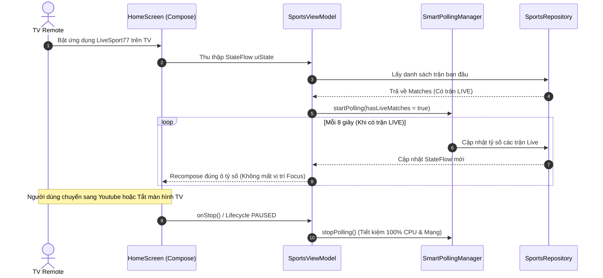

# 🎨 DESIGN: LiveSport77 - Android TV Native (Kotlin + Compose for TV)

**Ngày tạo:** 2026-11-10  
**Kiến trúc:** MVVM + Clean Architecture trên Android TV  
**Dựa trên:** [docs/specs/livesport77_tv_spec.md](file:///Users/hoanng/AIAgent/LiveSport/docs/specs/livesport77_tv_spec.md) và [docs/BRIEF.md](file:///Users/hoanng/AIAgent/LiveSport/docs/BRIEF.md)  
**Mục tiêu tài nguyên:** RAM < 60MB, CPU < 2% khi idle, 60fps mượt mà trên remote D-pad.

---

## 1. THIẾT KẾ DỮ LIỆU & BỘ NHỚ RAM (In-Memory State & Caching)

### 1.1. Sơ đồ dữ liệu thực thể (Entity Relationship)
```
┌────────────────────────────────────────────────────────┐
│  🏆 SPORT (Môn thể thao)                               │
│  ├── id: "football" | "basketball" | "tennis"          │
│  └── displayName: "Bóng đá" | "Bóng rổ" | "Quần vợt"  │
└───────────────────────────┬────────────────────────────┘
                            │ 1 Môn có nhiều Giải đấu
                            ▼
┌────────────────────────────────────────────────────────┐
│  🌐 LEAGUE (Giải đấu)                                  │
│  ├── id: String ("epl", "laliga", "nba", "atp")        │
│  ├── name: String ("Premier League", "NBA")            │
│  └── countryOrType: String                             │
└───────────────────────────┬────────────────────────────┘
                            │ 1 Giải có nhiều Trận đấu
                            ▼
┌────────────────────────────────────────────────────────┐
│  ⚽ MATCH (Trận đấu - @Immutable)                       │
│  ├── id: String                                        │
│  ├── status: LIVE | SCHEDULED | FINISHED               │
│  ├── statusDisplay: "78'" | "HT" | "FT" | "22:30"      │
│  ├── homeTeam / awayTeam: Team (id, name, logo)        │
│  ├── score: MatchScore (home, away, periodInfo)        │
│  ├── events: List<MatchEvent> (Goal, Card, Sub)        │
│  └── stats: MatchStats (Possession, Shots, Corners)    │
└────────────────────────────────────────────────────────┘
```

### 1.2. Chiến lược Tối Ưu RAM Trong Bộ Nhớ
- **StateFlow Đơn Nhất:** `SportsUiState` được quản lý tập trung trong `SportsViewModel`, phát qua StateFlow với toán tử `stateIn(WhileSubscribed(5000))` để tự động giải phóng khi TV chuyển màn hình.
- **Tái sử dụng View (`TvLazyColumn`):** Khi danh sách có 100 trận đấu, Android chỉ cấp phát bộ nhớ cho đúng 8 đối tượng UI `MatchItemCard` hiển thị trong khung nhìn TV.
- **Giới hạn Image Cache (Coil):** 
  ```kotlin
  ImageLoader.Builder(context)
      .memoryCache {
          MemoryCache.Builder(context)
              .maxSizePercent(0.10) // Tối đa 15MB RAM cho logo các đội
              .build()
      }
      .respectCacheHeaders(false)
      .build()
  ```

---

## 2. THIẾT KẾ MÀN HÌNH (TV 16:9 10-FOOT LAYOUT)

Ứng dụng chia thành 3 phân vùng chính cố định trên tỷ lệ 16:9 (1920x1080):

```
┌──────────────────────────────────────────────────────────────────────────────────────────────┐
│ [ZONE 1: TOP HEADER & SPORT BAR] (Chiều cao 120dp)                                           │
│ 🔴 LiveSport77  |  ⚽ Bóng đá  |  🏀 Bóng rổ  |  🎾 Quần vợt  |  [Tất cả | Live | Đã xong]   │
├───────────────────────────────────┬──────────────────────────────────────────────────────────┤
│ [ZONE 2: MATCH LIST RAIL] (35%)   │ [ZONE 3: MATCH DETAIL PANEL] (65%)                       │
│ (TvLazyColumn cuộn dọc)           │ (Hiển thị tức thì thông tin trận đấu đang focus)         │
│                                   │                                                          │
│ 🏆 Ngoại Hạng Anh                 │ ⚽ ARSENAL   2  -  1   CHELSEA (78' LIVE)                │
│ ┌───────────────────────────────┐ │ ────────────────────────────────────────────────────────  │
│ │ ARS  2 - 1  CHE   (78' LIVE)  │ │ ⏱️ DIỄN BIẾN TRẬN ĐẤU (TIMELINE)                         │
│ │ [Đang Focus - Viền vàng sáng] │ │  • 23' ⚽ Bukayo Saka (Kiến tạo: Odegaard)               │
│ └───────────────────────────────┘ │  • 55' ⚽ Martin Odegaard (Sút xa)                       │
│ ┌───────────────────────────────┐ │  • 68' ⚽ Cole Palmer (Penalty)                          │
│ │ MCI  - vs - LIV   (22:30)     │ │                                                          │
│ └───────────────────────────────┘ │ 📊 THỐNG KÊ TRỰC TIẾP (STATS)                            │
│                                   │  Kiểm soát bóng:  [████████░░░░░░] 58% - 42%             │
│ 🏆 La Liga                        │  Sút trúng đích:  6 - 3                                  │
│ ┌───────────────────────────────┐ │  Phạt góc:        5 - 2                                  │
│ │ RMA  1 - 0  BAR   (FT)        │ │                                                          │
│ └───────────────────────────────┘ │ 👥 ĐỘI HÌNH RA SÂN (LINEUP: 4-3-3 vs 4-2-3-1)           │
│                                   │ [Nhấn phím OK/Enter để xem Bảng tỷ số toàn màn hình]     │
└───────────────────────────────────┴──────────────────────────────────────────────────────────┘
```

---

## 3. THIẾT KẾ HỆ THỐNG FOCUS & REMOTE D-PAD

Hệ thống điều khiển D-pad tuân theo nguyên tắc **Spatial Navigation tự nhiên**:



### Quy tắc phản hồi Focus:
1. **Focus Visual:** Bất kỳ phần tử nào đang nhận Focus sẽ:
   - Scale tăng kích thước nhẹ: `scale(1.04f)` bằng hardware layer.
   - Viền sáng viền vàng kim thể thao (`#FFD700` hoặc `#00E676`) dày 2.5dp.
   - Thẻ nền nâng cao độ tương phản: nền xám đậm `#1E293B` trên phông nền đen OLED `#0B0F17`.
2. **Không mất Focus khi Data nhảy số:** Dùng `key(match.id)` trong Compose để tái sử dụng node, không tạo mới Node Focus khi tỷ số thay đổi.

---

## 4. LUỒNG CẬP NHẬT THỜI GIAN THỰC (SMART POLLING FLOW)



---

## 5. TEST CASES THIẾT KẾ (SDD & ACCEPTANCE CRITERIA)

### TC-01: Khởi động & Mặc định Focus
- **Given:** Người dùng mở ứng dụng LiveSport77 trên Android TV.
- **When:** Ứng dụng tải xong dữ liệu.
- **Then:**
  - Tab "Bóng đá" được chọn mặc định.
  - Con trỏ Focus tự động nhảy vào trận đấu LIVE đầu tiên của Cột Trái.
  - Màn hình chi tiết bên phải lập tức hiển thị thông tin trận đấu đó.
  - Mức RAM đo được bằng ADB < 55MB.

### TC-02: Điều khiển Remote D-pad Lên/Xuống
- **Given:** Focus đang ở trận 1 của Cột Trái.
- **When:** Bấm phím D-pad `DOWN`.
- **Then:**
  - Trận 2 nhận Focus với viền sáng rõ nét.
  - Màn hình chi tiết bên phải lập tức đổi sang hiển thị thông tin Trận 2.
  - Độ trễ chuyển đổi < 16ms (không giật khung hình).

### TC-03: Nhảy Focus sang Cột Phải & Xem Toàn Màn Hình
- **Given:** Focus đang ở danh sách trận.
- **When:** Bấm phím D-pad `RIGHT`.
- **Then:**
  - Focus nhảy sang các nút chức năng / timeline sự kiện ở Cột Phải.
- **When:** Bấm phím `OK/Enter`.
- **Then:**
  - Mở chế độ xem Big Scoreboard toàn màn hình.
- **When:** Bấm phím `BACK`.
- **Then:**
  - Trở về đúng vị trí trận đấu đang chọn trước đó.

### TC-04: Cập nhật Tỷ số Trực tiếp không làm rớt Focus
- **Given:** Người dùng đang focus vào Trận 3.
- **When:** Trận 1 có bàn thắng mới được cập nhật từ mạng.
- **Then:**
  - Ô tỷ số Trận 1 nhấp nháy cập nhật tỷ số mới.
  - Vị trí Focus tại Trận 3 của người dùng không bị gián đoạn hay mất focus.

